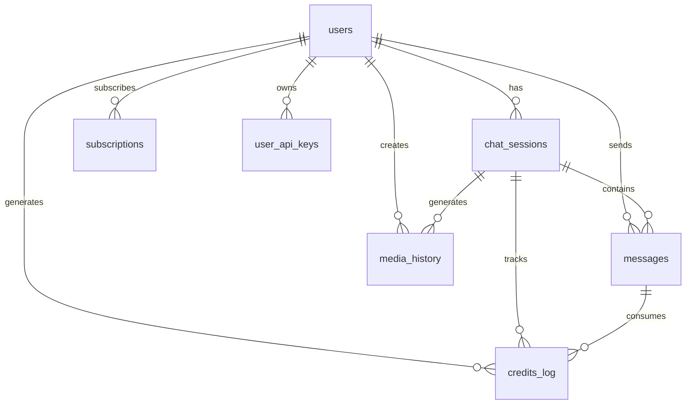

# GT Assistant Database Schema Documentation

## Overview

This document describes the complete database schema for GT Assistant after Week 3 database migration, including all tables, relationships, indexes, and security policies. **Updated for TEXT user_id compatibility with Clerk.**

## 📊 Database Architecture

### Core Tables
- **users** - User profiles synced with Clerk
- **chat_sessions** - Chat conversation sessions
- **messages** - Individual chat messages
- **media_history** - Generated media assets
- **credits_log** - Credit transaction audit trail
- **subscriptions** - User subscription management
- **user_api_keys** - BYOK (Bring Your Own Key) storage

## 🗃️ Table Schemas

### users
User profile table synced with Clerk authentication.

```sql
CREATE TABLE users (
  id TEXT PRIMARY KEY,                    -- Clerk user ID (TEXT for compatibility)
  email TEXT UNIQUE NOT NULL,             -- User email from Clerk
  credits INTEGER DEFAULT 10,             -- Current credit balance
  subscription_tier TEXT DEFAULT 'free',  -- Subscription tier
  daily_credits INTEGER DEFAULT 0,        -- Daily credit allowance
  last_credit_reset TIMESTAMP,            -- Last daily reset timestamp
  created_at TIMESTAMP DEFAULT NOW(),     -- Account creation time
  updated_at TIMESTAMP DEFAULT NOW()      -- Last profile update
);

-- Subscription tiers
-- 'free'    - 10 credits, no daily reset
-- 'basic'   - 300 daily credits
-- 'plus'    - 500 daily credits  
-- 'pro'     - Unlimited credits
```

**Indexes:**
- `idx_users_email` - Fast email lookups
- `idx_users_tier` - Filter by subscription tier
- `idx_users_credits` - Credit balance queries

**RLS Policies:**
- Users can view/update own profile only

### chat_sessions
Chat conversation sessions with user relationships.

```sql
CREATE TABLE chat_sessions (
  id UUID PRIMARY KEY DEFAULT gen_random_uuid(),
  title TEXT NOT NULL DEFAULT 'New Conversation',
  preview TEXT DEFAULT '',
  user_id TEXT REFERENCES users(id) ON DELETE SET NULL,  -- TEXT for Clerk compatibility
  updated_at TIMESTAMP DEFAULT NOW()
);
```

**Indexes:**
- `idx_chat_sessions_user` - User-specific sessions
- `idx_chat_sessions_updated` - Recent sessions

**RLS Policies:**
- Users can only access their own sessions

### messages
Individual chat messages with credit tracking.

```sql
CREATE TABLE messages (
  id UUID PRIMARY KEY DEFAULT gen_random_uuid(),
  session_id UUID REFERENCES chat_sessions(id) ON DELETE CASCADE,
  user_id TEXT REFERENCES users(id) ON DELETE SET NULL,  -- TEXT for Clerk compatibility
  role TEXT NOT NULL CHECK (role IN ('user', 'assistant')),
  content JSONB NOT NULL,                   -- Message content (text or structured)
  cost_credits INTEGER DEFAULT 0,          -- Credits consumed by this message
  audio_url TEXT,                          -- TTS audio URL
  created_at TIMESTAMP DEFAULT NOW()
);
```

**Indexes:**
- `idx_messages_user` - User-specific messages
- `idx_messages_session` - Session message ordering
- `idx_messages_cost` - Credit usage analysis

**RLS Policies:**
- Users can only access their own messages

### media_history
Generated media assets (images, videos).

```sql
CREATE TABLE media_history (
  id UUID PRIMARY KEY DEFAULT gen_random_uuid(),
  session_id UUID REFERENCES chat_sessions(id) ON DELETE CASCADE,
  user_id TEXT REFERENCES users(id) ON DELETE SET NULL,  -- TEXT for Clerk compatibility
  type TEXT NOT NULL CHECK (type IN ('image', 'video')),
  title TEXT NOT NULL,
  url TEXT NOT NULL,                        -- Public storage URL
  prompt TEXT,                             -- Generation prompt
  created_at TIMESTAMP DEFAULT NOW()
);
```

**Indexes:**
- `idx_media_history_user` - User-specific media
- `idx_media_history_session` - Session media
- `idx_media_history_type` - Media type filtering

**RLS Policies:**
- Users can only access their own media

### credits_log
Complete audit trail of all credit transactions.

```sql
CREATE TABLE credits_log (
  id UUID PRIMARY KEY DEFAULT gen_random_uuid(),
  user_id TEXT NOT NULL REFERENCES users(id) ON DELETE CASCADE,  -- TEXT for Clerk compatibility
  amount INTEGER NOT NULL,                 -- Negative for usage, positive for purchases
  action TEXT NOT NULL CHECK (action IN (
    'chat', 'image', 'video', 'edit', 'purchase', 'daily_reset', 'refund'
  )),
  model_used TEXT,                         -- AI model used (if applicable)
  session_id UUID REFERENCES chat_sessions(id) ON DELETE SET NULL,
  remaining_balance INTEGER,               -- Balance after transaction
  metadata JSONB DEFAULT '{}',             -- Additional transaction data
  created_at TIMESTAMP DEFAULT NOW()
);
```

**Indexes:**
- `idx_credits_log_user` - User transaction history
- `idx_credits_log_action` - Transaction type analysis
- `idx_credits_log_session` - Session credit usage

**RLS Policies:**
- Users can view own credit logs only

### subscriptions
User subscription management for paid tiers.

```sql
CREATE TABLE subscriptions (
  id UUID PRIMARY KEY DEFAULT gen_random_uuid(),
  user_id TEXT NOT NULL REFERENCES users(id) ON DELETE CASCADE,  -- TEXT for Clerk compatibility
  paystack_subscription_id TEXT UNIQUE,    -- Paystack subscription ID (replaces Stripe)
  paystack_customer_code TEXT,             -- Paystack customer code
  tier TEXT NOT NULL CHECK (tier IN ('basic', 'plus', 'pro')),
  status TEXT NOT NULL CHECK (status IN ('active', 'canceled', 'past_due', 'trialing')),
  price_amount INTEGER NOT NULL,           -- Price in cents/kobo
  currency TEXT DEFAULT 'kes',             -- Currency code
  interval TEXT NOT NULL CHECK (interval IN ('monthly', 'yearly')),
  current_period_start TIMESTAMP,          -- Current billing period start
  current_period_end TIMESTAMP,            -- Current billing period end
  cancel_at_period_end BOOLEAN DEFAULT false,
  created_at TIMESTAMP DEFAULT NOW(),
  updated_at TIMESTAMP DEFAULT NOW()
);
```

**Indexes:**
- `idx_subscriptions_user` - User subscriptions
- `idx_subscriptions_status` - Status filtering
- `idx_subscriptions_paystack` - Paystack webhook lookups

**RLS Policies:**
- Users can view own subscriptions
- System can manage all subscriptions

### user_api_keys
Secure storage for user-provided API keys (BYOK).

```sql
CREATE TABLE user_api_keys (
  id UUID PRIMARY KEY DEFAULT gen_random_uuid(),
  user_id TEXT NOT NULL REFERENCES users(id) ON DELETE CASCADE,  -- TEXT for Clerk compatibility
  service TEXT NOT NULL CHECK (service IN ('chutes', 'tavily', 'brave')),
  key_name TEXT NOT NULL,                  -- User-friendly key name
  encrypted_key TEXT NOT NULL,             -- Encrypted API key
  is_active BOOLEAN DEFAULT true,          -- Key usage status
  usage_count INTEGER DEFAULT 0,           -- Usage tracking
  last_used_at TIMESTAMP,                  -- Last usage timestamp
  created_at TIMESTAMP DEFAULT NOW(),
  updated_at TIMESTAMP DEFAULT NOW()
);
```

**Indexes:**
- `idx_user_api_keys_user` - User's API keys
- `idx_user_api_keys_service` - Service-specific keys

**RLS Policies:**
- Users can manage own API keys only

## 🔧 Database Functions

### deduct_user_credits
Atomically deducts credits from user account with audit logging.

```sql
SELECT * FROM deduct_user_credits(
  p_user_id := 'user_36vSe3hO7LmgtIhM4D4pVfovrnz',  -- TEXT Clerk ID
  p_amount := 3,
  p_action := 'chat',
  p_model_used := 'zai-org/GLM-4.6',
  p_session_id := 'session-uuid'
);
```

**Returns:**
- `success` (boolean) - Whether deduction succeeded
- `new_balance` (integer) - Updated credit balance
- `message` (text) - Success/error message

### add_user_credits
Adds credits to user account (for purchases).

```sql
SELECT add_user_credits(
  p_user_id := 'user_36vSe3hO7LmgtIhM4D4pVfovrnz',  -- TEXT Clerk ID
  p_amount := 100,
  p_action := 'purchase',
  p_purchase_id := 'paystack-reference-id'
);
```

### sync_user_profile
Creates/updates user profile from Clerk data.

```sql
SELECT sync_user_profile(
  p_user_id := 'user_36vSe3hO7LmgtIhM4D4pVfovrnz',  -- TEXT Clerk ID
  p_email := 'user@example.com'
);
```

### reset_daily_credits
Resets daily credits for paid tier users.

```sql
SELECT reset_daily_credits();  -- Returns number of users reset
```

## 🔐 Security Policies

### Row Level Security (RLS)
All user-specific tables have RLS enabled with policies ensuring users can only access their own data.

### Key Security Features:
- **User Isolation**: Users can only access their own data
- **Atomic Operations**: Credit deductions use row-level locks
- **Audit Trail**: All credit transactions are logged
- **Encrypted Storage**: API keys are encrypted at rest
- **Input Validation**: All inputs have CHECK constraints

## 📈 Performance Optimization

### Indexes
- Foreign key relationships are indexed
- Common query patterns have dedicated indexes
- Composite indexes for complex queries

### Query Patterns
```sql
-- User's recent sessions
SELECT * FROM chat_sessions 
WHERE user_id = $1 
ORDER BY updated_at DESC 
LIMIT 10;

-- User's credit usage (last 30 days)
SELECT action, COUNT(*), SUM(ABS(amount)) as total_credits
FROM credits_log 
WHERE user_id = $1 AND created_at > NOW() - INTERVAL '30 days'
GROUP BY action;

-- User's media gallery
SELECT * FROM media_history 
WHERE user_id = $1 
ORDER BY created_at DESC;
```

## 🔄 Data Relationships



## 📊 Credit System Logic

### Credit Costs
```typescript
const CREDIT_COSTS = {
  chat: {
    'zai-org/GLM-4.6': 1,
    'moonshotai/Kimi-K2-Thinking': 3,
    'deepseek-ai/DeepSeek-R1-0528': 3,
  },
  image: {
    'hunyuan': 3,
    'qwen-image': 3,
    'z-image-turbo': 2,
    'hidream': 5,
  },
  video: {
    'wan-2.2-i2v': 10,
    'wan-2.1-t2v': 10,
  },
  edit: {
    'qwen-image-edit': 4,
  },
};
```

### Subscription Tiers
- **Free**: 10 credits total
- **Basic**: 300 daily credits (1000 KES/month)
- **Plus**: 500 daily credits (2000 KES/month)
- **Pro**: Unlimited credits (3000 KES/month)

## 🚀 API Endpoints

### Supabase Client Methods
See `services/supabase.ts` for complete API surface.

### Key Methods:
- `getUserProfile(userId)` - Get user profile
- `useCredits(userId, amount, action, model)` - Deduct credits
- `purchaseCredits(userId, amount)` - Add credits
- `getUserCreditsHistory(userId)` - Get transaction history
- `createSubscription(userId, data)` - Create subscription
- `getUserStats(userId)` - Get usage statistics

### Real-time Subscriptions
```typescript
// Subscribe to credit updates
const channel = supabaseService.subscribeToCredits(userId, (newCredits) => {
  console.log('Credits updated:', newCredits);
});

// Subscribe to all user updates
const channels = supabaseService.subscribeToUserUpdates(userId, {
  onProfileUpdate: (profile) => console.log('Profile updated', profile),
  onCreditChange: (credits) => console.log('Credits changed', credits),
  onSubscriptionChange: (sub) => console.log('Subscription changed', sub),
});
```

## 📋 Migration History

### Week 3 - Database Migration (December 17, 2025)
- **MIGRATED**: From UUID to TEXT user_id for Clerk compatibility
- Created new Supabase project with TEXT-based schema
- Updated all table relationships to use TEXT user_id
- Fixed RLS policies for TEXT user IDs
- Resolved Clerk-Supabase sync issues
- Environment variables updated for new database

### Week 2 - Credit System & User Management
- Added user relationships to existing tables
- Created credit system tables
- Implemented RLS policies
- Added atomic credit deduction functions
- Created subscription management
- Added BYOK support

### Future Migrations
- Week 4: Payment integration (Paystack webhooks)
- Week 7: Message branching support
- Week 10: Enhanced media metadata

---

**Last Updated**: 2025-12-19  
**Version**: 1.1  
**Schema Version**: week3_v1 (TEXT user_id)